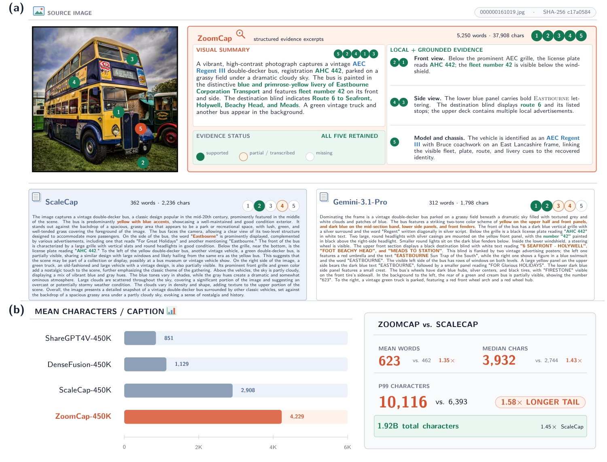
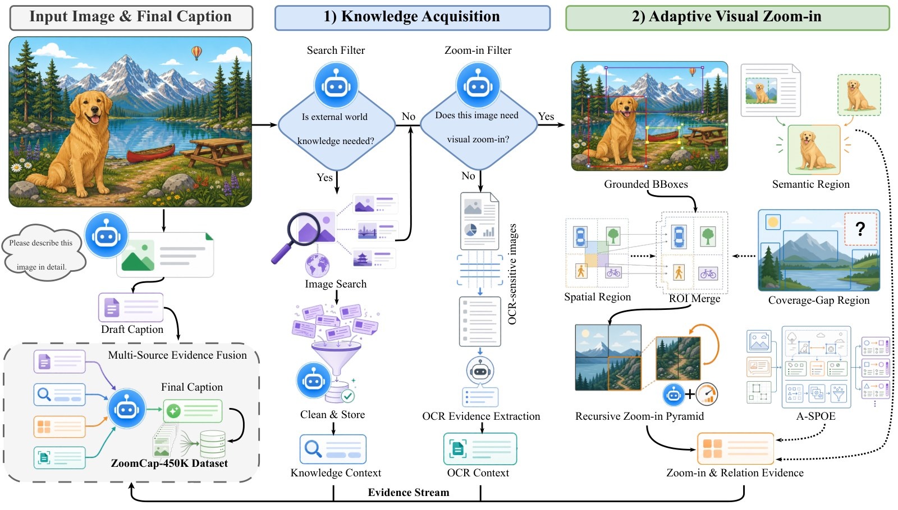
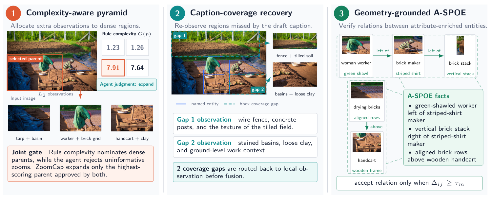
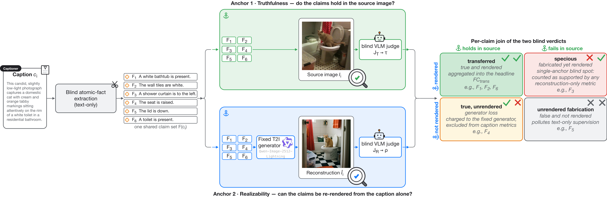
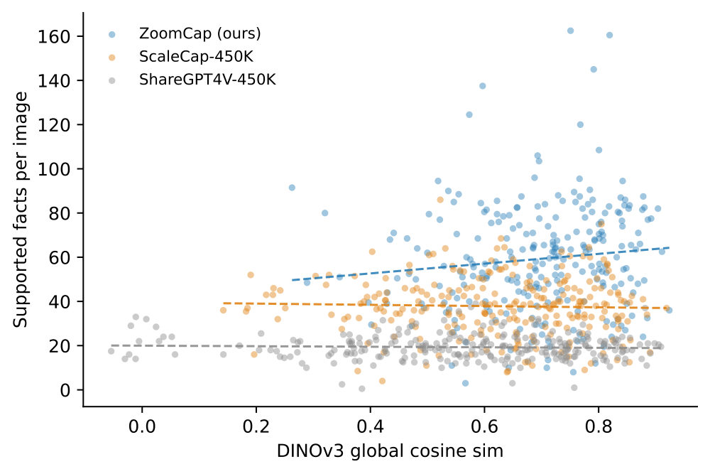
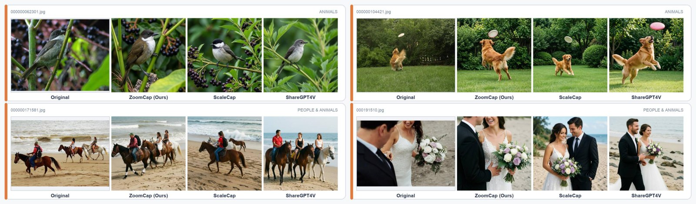
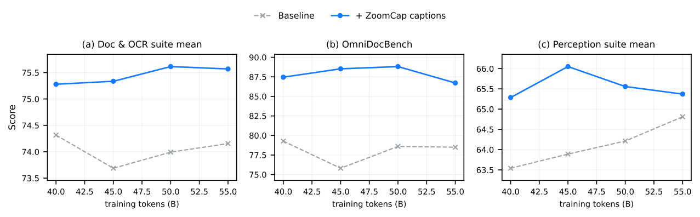
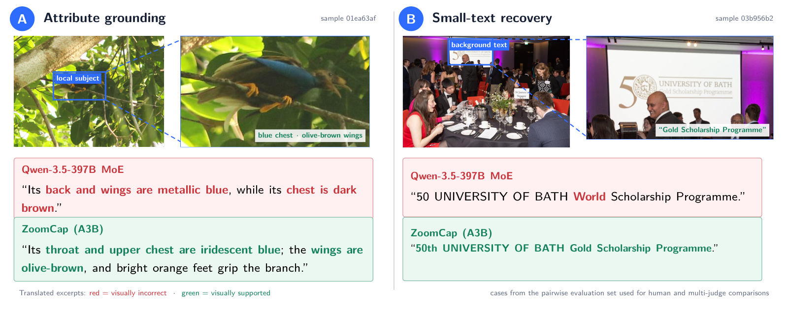
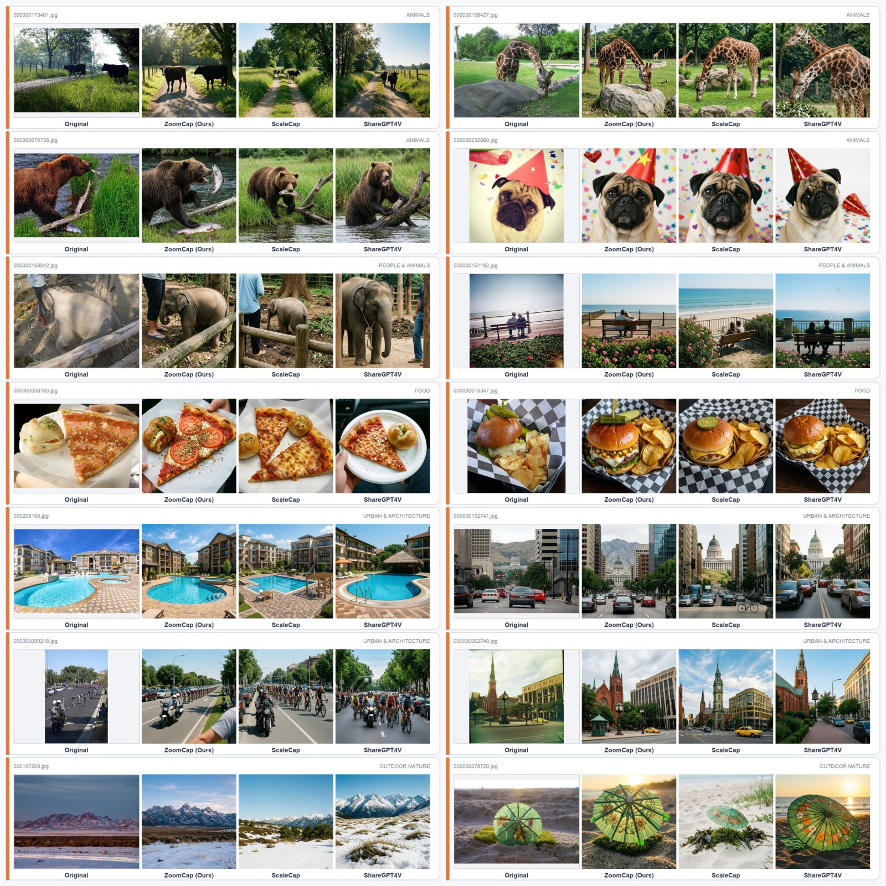

<div align="center">

# ZoomCap: Evidence-Routed Visual Zooming for Recoverable Visual Information Transfer

**Hao Shi<sup>1,2∗</sup> · Jiafeng Wang<sup>1∗</sup> · Yuzhuo Fu<sup>1</sup> · Tao Zhang<sup>1</sup> · Jian Bai<sup>2</sup> · Juelu Zhang<sup>1</sup> · Qing Cui<sup>1</sup> · Chao Huang<sup>1†</sup>**

<sup>1</sup>Ant Group   ·   <sup>2</sup>Zhejiang University    <sup>∗</sup>equal contribution    <sup>†</sup>team leader

<a href="https://huggingface.co/datasets/MasterHow/ZoomCap-450K"></a>
<a href="https://arxiv.org/abs/2610.21320"></a>


<a href="https://masterhow.github.io/ZoomCap-450K/"></a>
<a href="https://github.com/MasterHow/ZoomCap-450K/issues"></a>

</div>

---

<p align="center"></p>

**One image, five facts a single-pass captioner never recovers.** (a) Targets that are partial or missing from
ScaleCap and Gemini-3.1-Pro captions but retained by ZoomCap. (b) ZoomCap-450K carries **1.45×** ScaleCap's total
characters and a **1.58×** larger P99 caption length.

**ZoomCap** treats fine-grained captioning as *recoverable visual information transfer*: a draft caption routes an
agentic evidence budget — external-knowledge search, OCR-sensitive reading, coverage-gap re-observation and adaptive
visual zooming — and only the most complex eligible region is cropped deeper. With a teacher **10× smaller** than the
flagship baseline it wins an **81.9%** human tie-adjusted preference, transfers **1.7× more claims per image** than
ScaleCap (**52.4** vs 31.5), costs **$0.0077/image** (3.6× cheaper than the ScaleCap recipe, **5.9×** cheaper per
transferred claim), and as training data it lifts the 11-benchmark continual-pre-training average by
**+1.31 … +2.38** over the strongest competing 450K corpus.

## Abstract

> Detailed captions transfer visual information into vision-language model supervision, but quality is easily
> conflated with length: long single-pass outputs still miss small objects, text, and spatial relations or promote
> uncertain observations into confident claims. We formulate fine-grained captioning as **recoverable visual
> information transfer**, in which a teacher acquires missing evidence under a finite observation budget and converts
> it into reusable supervision. **ZoomCap** uses a draft caption to route conditional knowledge retrieval,
> OCR-sensitive reading, coverage-gap recovery, and adaptive visual zooming, allocating deeper crops only to the most
> complex eligible region, deriving spatial relations from grounded geometry, and fusing non-duplicate evidence. We
> also introduce **FactCycle**, which scores caption-derived atomic claims on two blind anchors — source image
> (truthfulness) and reconstruction (realizability) — separating fabrication from generator loss claim by claim; human
> and multi-judge comparisons complement this fact-level view. Against Qwen3.5-397B-A17B captions, ZoomCap achieves an
> 81.9% human tie-adjusted preference score with a teacher over 10× smaller, and FactCycle counts 52.4 transferred
> claims per image vs. 31.5 for ScaleCap. The evidence also transfers: in continual pre-training, ZoomCap-450K improves
> the 11-benchmark average by 1.31–2.38 points over the strongest competing corpus and Ling-Tiny-VL-v3 gains 1.4 points
> on a production document/OCR monitor suite (+0.90 platform-wide) at 60B tokens; in medical pre-training, 2.64M
> ZoomCap-captioned images improve five VQA benchmarks by 3.04 points (vs. 1.76 for same-image Gemini-3.1-Pro captions).

## Method: route the budget, don't spend it everywhere

<p align="center"></p>

From a raw image and a draft caption, ZoomCap routes each sample through agentic evidence acquisition — external
knowledge search, OCR extraction for text/chart/document-like images, and adaptive visual zoom-in for detail-rich
scenes — then fuses non-duplicate evidence into the final caption.

<p align="center"></p>

* **Complexity-gated zooming.** Rule complexity nominates dense parents, the agent rejects uninformative zooms, and
  only the highest-scoring parent approved by both expands — gating prunes **20.2%** of first-level and **39.8%** of
  second-level crops while *improving* paired preference.
* **OCR routing.** The reading branch fires on **174K / 455K images (≈39%)** — whenever visible text, signs, menus or
  packaging appear; knowledge retrieval fires on only ≈8%, because this natural-image pool contains few identifiable
  named entities.
* **Coverage-gap recovery.** Draft-grounded entity boxes reveal claims the draft asserts but cannot localize, and
  trigger targeted re-observation.
* **Budget.** ≈9 calls and ≈25K tokens per image, **$0.0077/image**, ≈29 s wall-clock asynchronously — every stage
  writes its evidence artefacts, so a failure is traceable to routing, search, OCR, patches, relations or fusion.

## FactCycle: score claims against two blind anchors

<p align="center"></p>

The same blind-extracted claim set is scored against the **source image** (truthfulness) and against a **fixed-generator
reconstruction** (realizability). Joining the two verdicts per claim separates fabrication from generator loss, so a
caption is credited only for claims that are both true *and* recoverable.

| Caption source | #Facts/img ↑ | τ truthfulness % ↑ | transferred % ↑ | specious % ↓ | unrendered fab. % ↓ | **FC<sub>trans</sub>** ↑ | DINO ↑ |
| --- | --- | --- | --- | --- | --- | --- | --- |
| ShareGPT4V-450K | 20.7 | 81.4 | 80.3 | 16.6 | 2.0 | 14.8 | 0.566 |
| ScaleCap-450K | 41.9 | 88.9 | 88.2 | 7.4 | 2.6 | 31.5 | 0.620 |
| **ZoomCap-450K (ours)** | **67.1** | **93.8** | **90.9** | **3.4** | **1.7** | **52.4** | **0.696** |

<p align="center"></p>

Each point is one FactCycle-250 image: ZoomCap occupies the high-support, high-similarity corner — more claims *and*
more of them renderable.

<p align="center"></p>

Same source image, same fixed text-to-image generator, only the caption source changes: ZoomCap reconstructions keep
more of the source composition and fine-grained content.

## Results

### Equal-scale continual pre-training (11 benchmarks, average)

| Backbone | Vanilla | ShareGPT4V-450K | DenseFusion-450K | ScaleCap-450K | **ZoomCap-450K** |
| --- | --- | --- | --- | --- | --- |
| Qwen2.5-7B + Qwen2.5-ViT | 59.16 | 59.46 | 60.44 | 60.48 | **62.70** |
| Qwen2.5-3B + Qwen2.5-ViT | 54.84 | 56.90 | 58.42 | 58.22 | **60.80** |
| Ling-mini-base-2.0 + Qwen2.5-ViT | 55.49 | 57.72 | 58.90 | 58.03 | **60.21** |

Same checkpoint, recipe, seed and token budget — only the caption corpus changes. Across the 11 benchmarks
(InfoVQA, DocVQA, ChartQA, MMStar, MathVista, LLaVABench, MMVet, MMB, MMMU, SEED, AI2D) ZoomCap wins the average on all
three backbones: **+2.22 / +2.38 / +1.31** over the strongest competitor.

### Production adoption

<p align="center"></p>

Matched production runs of `Ling-Tiny-VL-v3` under a common 60B-token budget, ZoomCap captions replacing 20% of the
caption group:

| Suite / benchmark | Baseline | + ZoomCap |
| --- | --- | --- |
| **Doc & OCR suite (9 benchmarks)** | 74.0 | **75.4** (+1.4) |
| OmniDocBench | 78.0 | **87.9** (+9.8) |
| OCRBenchV2-b | 46.2 | **48.5** (+2.2) |
| **Perception suite (9 benchmarks)** | 64.1 | **65.6** (+1.5) |
| MMVet | 49.9 | **61.7** (+11.8) |

In the medical study, 2.64M ZoomCap-captioned images improve five medical VQA benchmarks by **+3.04** on average,
versus **+1.76** for same-image single-pass Gemini-3.1-Pro captions, and turn VQA-RAD from a small regression into +3.1.

### Human and judge preference (PrefBench-456)

<p align="center"></p>

Two-alternative forced choice against Qwen3.5-397B-A17B captions, six annotators and three VLM judges: **81.9%**
tie-adjusted preference with a teacher over 10× smaller, concentrated on knowledge richness and information coverage —
exactly the two evidence streams ZoomCap routes.

### Captioning cost

| Engine | Teacher | Calls/img | $/img | Wall-clock | $ / transferred claim |
| --- | --- | --- | --- | --- | --- |
| Single-pass flagship | Qwen3.5-397B-A17B | 1 | 0.0067 | ~17 s | — |
| ScaleCap-450K recipe | Qwen3.5-35B-A3B | ~70 | 0.0274 | ~123 s | 8.7 × 10⁻⁴ |
| **ZoomCap (ours)** | Qwen3.5-35B-A3B | **~9** | **0.0077** | **~29 s** | **1.5 × 10⁻⁴** |

## Dataset: ZoomCap-450K

<a href="https://huggingface.co/datasets/MasterHow/ZoomCap-450K">🤗 huggingface.co/datasets/MasterHow/ZoomCap-450K</a> —
captions only, **CC BY-NC 4.0, research use only**. Each row is a drop-in replacement for ScaleCap-450k: same
`images` + `conversations` schema, so a ScaleCap training recipe runs against it unchanged.

| | rows | unique image keys | mean caption chars |
| --- | --- | --- | --- |
| public config `pii_free` | 447,285 | 432,755 | 3,966.0 |
| withheld `clean` / `full` | 451,276 / 454,963 | 436,642 / 440,238 | 3,963.3 / 4,228.6 |

The withheld configurations keep every caption byte-identical to the corpus the paper reports (the degenerate tail and
the rows that transcribe contact strings visible in the source image); they require a separate data-release approval —
open an issue to ask.

**No images are redistributed.** Rows carry the upstream image key, so join them to
[ScaleCap-450k](https://huggingface.co/datasets/long-xing1/ScaleCap-450k) (or to your local ShareGPT4V / LAION pool):

```python
from datasets import load_dataset

ds = load_dataset("MasterHow/ZoomCap-450K", "pii_free", split="train")
print(ds[0]["images"], ds[0]["conversations"][1]["value"][:120])
# ['laion_filter_image/7156c3a9…8b910b.jpg']  This dynamic, close-up action shot captures three …
```

A 1,000-row sample is in [`sample/`](sample/), and the full dataset card (provenance, licence chain, QC and PII
census) is [`docs/dataset_card.md`](docs/dataset_card.md).

### Reproduce the corpus

`tools/` holds the pipeline that produced the release and every check it passed — key sanitising, degeneracy QC, the
PII census, the internal-identifier scan, the upstream-join verification and the recomputed corpus statistics. The
sanitised verification reports ship in [`docs/verification/`](docs/verification); see
[`docs/TOOLING.md`](docs/TOOLING.md) for the runbook.

```
tools/build_release.py          ->  configs + stats.json + release_manifest.json + PII census
tools/verify_join.py            ->  schema contract, parquet loadability, upstream key membership
tools/verify_pii_free.py        ->  independent re-scan proving the public config is contact-free
tools/scan_leaks.py             ->  internal-identifier scan (data tier and code tier)
tools/compute_corpus_stats.py   ->  the paper's corpus-statistics columns, recomputed
```

## More reconstruction examples

<p align="center"></p>

## Citation

```bibtex
@article{shi2026zoomcap,
  title   = {ZoomCap: Evidence-Routed Visual Zooming for Recoverable Visual Information Transfer},
  author  = {Shi, Hao and Wang, Jiafeng and Fu, Yuzhuo and Zhang, Tao and
             Bai, Jian and Zhang, Juelu and Cui, Qing and Huang, Chao},
  journal = {arXiv preprint arXiv:2610.21320},
  year    = {2026}
}
```

## Acknowledgements

The image pool comes from [ScaleCap-450k](https://huggingface.co/datasets/long-xing1/ScaleCap-450k)
([Xing et al., 2025](https://arxiv.org/abs/2506.19848)), itself built on
[ShareGPT4V](https://arxiv.org/abs/2311.12793) and [LAION-5B](https://arxiv.org/abs/2210.08402). We redistribute no
images: obtaining them remains the user's responsibility under those upstream terms, and this corpus is released under
the same CC BY-NC 4.0 licence so no user gains rights beyond what the upstream corpus grants.

## Licence and use limits

Data **CC BY-NC 4.0** (research only, non-commercial) · code in this repository **Apache-2.0** · see
[`LICENSE`](LICENSE) and [`NOTICE.md`](NOTICE.md). Captions are model-generated and may contain hallucinated detail;
this corpus is not for medical, legal, diagnostic, identification or surveillance use.
